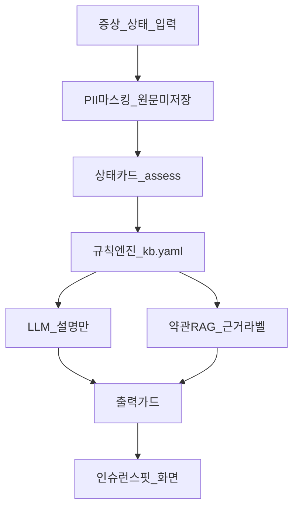

# 인슈런스핏 (health-insurance-chatbot)

> 식별자 없이, 증상·상태로 실손 **보장 유형을 비교 안내**합니다.  
> 내부 코드명 `harag`. 의료 진단이 아니며 특정 보험 상품을 권유하지 않습니다.

로그인·주민번호·연락처 없이 증상 칩(또는 한 줄)과 선택적 직업·걱정만 받습니다.  
**규칙 엔진이 보장 후보를 정하고**, LLM은 그 범위 안에서만 설명합니다.  
약관 PDF를 올리면 근거 라벨을 붙입니다. 문서 질의에서 근거가 없으면 지어내지 않고 “모른다”고 답합니다(abstain).

---

## 기존 사이트와 무엇이 다른가

대형 보험사·비교 사이트는 보통 **계정과 식별자**로 정확도를 만듭니다. ID/PW, 주민·연락처, 병력 설문을 받은 뒤 그 사람 명의의 상품을 고르는 동선입니다.

인슈런스핏은 그 반대입니다.

| | 기존 건강보험 추천·안내 사이트 | 인슈런스핏 |
|---|---|---|
| 입장 | 로그인, 식별자, 상세 개인정보 | 로그인 없음. 증상·상태만 |
| 결정권 | 상품 카탈로그·상담사·범용 LLM | **규칙**이 후보를 정함. LLM은 문장화만 |
| 결과 | 특정 보험사 상품 권유에 가깝 | **보장 유형 비교 안내**. 상품명 권유 없음 |
| 근거 | 약관과 입력이 섞이거나 FAQ 챗봇 | 올린 약관에서만 근거. 없으면 abstain |
| 데이터 | 계정에 원문 보관 | 안내 원문은 세션에 안 넣음. 형식 PII는 즉시 가림 |

표현은 “개인정보를 전혀 안 받는다”가 아닙니다. 증상도 민감할 수 있습니다.  
**식별자 없이 상태만 받아 즉시 비식별**하고, 출력 가드가 진단 단정을 막습니다.

상세: [docs/TARGET_ARCHITECTURE.md](docs/TARGET_ARCHITECTURE.md) §5, [docs/PROFESSOR_FEEDBACK.md](docs/PROFESSOR_FEEDBACK.md) §4–5.

---

## 어떻게 동작하는가

기본 화면은 상태 안내입니다. 문서 질의 탭은 약관 RAG를 **병행**합니다. FAQ형 챗봇이 목표가 아닙니다.



- **상태 안내:** `POST /v1/assess` → 상태 카드, `POST /v1/guidance` → 보장 비교 + 면책
- **약관 적재:** PDF → 파싱(pdfplumber) → 구조 청킹 → PII 마스킹 → 임베딩 → Qdrant
- **문서 질의:** 검색(소유자 격리) → LLM → 출처 / abstain (SSE)

키(임베딩/LLM)가 없으면 로컬 폴백(해시 임베딩 + 추출형 답변)으로 데모됩니다.

현재 구현·문서 위치: [docs/CURRENT_ARCHITECTURE.md](docs/CURRENT_ARCHITECTURE.md).  
스택: [docs/TECH_STACK.md](docs/TECH_STACK.md).  
약관 RAG 뒷단 설계 자산: [MASTER_DESIGN.md](MASTER_DESIGN.md) (행정문서 FAQ RAG — 제품 목표가 아님).

---

## 빠른 시작 (Docker)

```bash
cp .env.example .env      # (선택) 키 입력. 비워두면 로컬 폴백
docker compose up --build
# http://localhost:8000  → 증상 안내가 기본 화면
```

운영 품질은 `.env`에 Gemini(Google AI Studio) 키를 넣습니다.

```dotenv
LLM_API_BASE=https://generativelanguage.googleapis.com/v1beta/openai
LLM_API_KEY=...
LLM_MODEL=gemini-3.5-flash
LLM_REWRITE_MODEL=gemini-3.1-flash-lite
EMBEDDING_API_BASE=https://generativelanguage.googleapis.com/v1beta/openai
EMBEDDING_API_KEY=...
EMBEDDING_MODEL=gemini-embedding-001
EMBEDDING_DIM=768
EMBEDDING_SEND_DIMENSIONS=true
RATE_LIMIT_QPM=5
```

과금·한도: [docs/GEMINI_COST_STRATEGY.md](docs/GEMINI_COST_STRATEGY.md).  
실행 상세: [docs/실행_가이드.md](docs/실행_가이드.md).  
임베딩 모델·차원을 바꾸면 Qdrant 컬렉션을 새로 만들고 약관을 다시 올립니다.

## 빠른 시작 (로컬)

Python 3.11+ 필요.

```bash
python -m venv .venv && source .venv/bin/activate
pip install -e .
# QDRANT_URL 비우면 인메모리(:memory:). 재시작 시 인덱스 소실
uvicorn harag.api.main:app --app-dir src --reload
# http://localhost:8000
```

```bash
pip install httpx
BASE=http://localhost:8000 python scripts/smoke.py
```

---

## API 요약

| 메서드 | 경로 | 설명 |
|---|---|---|
| POST | `/v1/assess` | 상태 카드(마스킹 미리보기·증상 코드). 원문 미저장 |
| POST | `/v1/guidance` | 규칙 기반 보장 비교 JSON + 면책. 원문 미저장 |
| POST | `/v1/documents` | PDF 업로드. 202 + `document_id`. 비동기 처리 |
| GET | `/v1/documents` | 내 문서 목록/상태 |
| GET | `/v1/documents/{id}` | processing / ready / failed |
| DELETE | `/v1/documents/{id}` | 본인 문서 삭제 |
| POST | `/v1/query` | 약관 질의 → 답변+출처(JSON) |
| POST | `/v1/query/stream` | 약관 질의 → SSE |
| GET | `/health` | 헬스체크 |

소유자 격리는 `X-Owner-Id`(브라우저 UUID). 없으면 `anonymous`.  
`AUTH_JWT_SECRET`이 있으면 Bearer JWT를 강제합니다.

---

## 한계

- 스캔(이미지) PDF는 텍스트 추출 불가 → `failed` (OCR 없음).
- PII는 주민·전화·이메일 등 **형식 정규식**만. 이름·주소 NER은 없음.
- 안내 원문은 세션에 안 넣습니다. 올린 약관 청크는 마스킹 후 Qdrant/SQLite에 남습니다.
- `QDRANT_URL`이 비면 인메모리라 **서버 재시작 시 약관 인덱스가 사라집니다.**
- 원본 TTL 감사·규칙 이탈률 등 TARGET §4 지표는 아직 집계하지 않습니다.
- 로컬 폴백 임베딩/LLM은 데모용입니다.

남은 일: [REMAINING_WORK.md](REMAINING_WORK.md).

---

## 구조

```
src/harag/
  guidance/                 증상 사전·규칙 엔진·출력 가드
  security/pii.py           형식 PII 마스킹
  parsing/pdf_parser.py     PDF → DocumentIR
  chunking/chunker.py       구조 기반 청킹
  embedding/                API / 로컬 해시 + TPM 페이싱
  retrieval/qdrant_store.py 하이브리드 검색, owner 필터
  generation/               abstain·인용 검증
  api/                      FastAPI (assess, guidance, ingest, query)
frontend/                   인슈런스핏 UI (sangtae.js / sangtae.css)
```

```bash
pip install -e ".[dev]"
pytest -q
```
