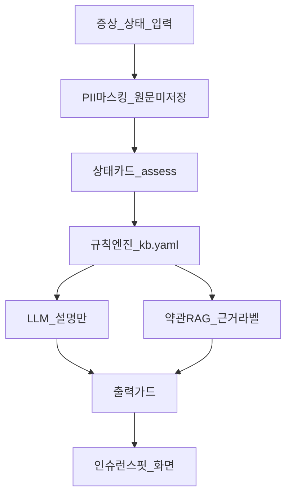

# 인슈런스핏 (health-insurance-chatbot)

> 로그인·본인인증 없이, 증상·상태와 최소 범주 정보로 실손 **보장 유형을 비교 안내**합니다.  
> 내부 코드명 `harag`. 의료 진단이 아니며 특정 보험 상품을 권유하지 않습니다.  
> **가입 전 탐색 단계의 사전 안내**이지, 기가입 분석·가입 심사의 대체재가 아닙니다.

로그인 없이 증상 칩(또는 한 줄)과 선택적 직업군·걱정만 받습니다.  
**규칙 엔진이 보장 후보를 정하고**(MVP), LLM은 그 범위 안에서만 설명합니다.  
현재 구현은 약관 PDF를 올리면 근거 라벨을 붙입니다. 문서 질의에서 근거가 없으면 지어내지 않고 “모른다”고 답합니다(abstain).

---

## 기존 사이트와 무엇이 다른가

확인한 범위에서 시중 서비스는 정확도를 만드는 방식이 갈립니다. 한 유형으로 묶지 않습니다.

| 유형 | 대표 예 | 정확도를 만드는 방식 |
|---|---|---|
| 기가입 보험 조회·보장분석 | 보맵, 시그널플래너, SKT PASS 금융비서 | 본인인증과 데이터 연결 |
| 비교·추천 플랫폼 | 네이버·카카오페이·토스 등 | 연령·성별 등 입력으로 상품 비교 |
| 보험사·설계사 상담 | 각 보험사 사이트, 상담 연결 | 병력·직업 등 심사 정보 |

기가입 분석형은 가입 보험을 연결할수록 분석이 정확해진다고 안내합니다. 공공 조회(내보험찾아줌)도 본인인증이 필요합니다. 비교·추천형은 성별·나이·필요 보장에 따라 상품을 나란히 비교합니다. 가입 단계에서는 병력·투약·직업·기존 가입이 복합적으로 가입 여부를 가릅니다.

### 인슈런스핏의 실질적 차별점

1. **시작점이 다릅니다.** 기존 서비스는 기가입 보험 데이터 또는 상품에서 출발합니다. 이 서비스는 증상·상태에서 출발해 보장 유형으로 연결합니다. 확인한 범위에서는 증상 기반 안내를 찾지 못했습니다(검색 몇 건으로 “없다”고 단정하지는 않습니다).
2. **입력 모델이 다릅니다.** 본인인증이나 데이터 연결 없이 시작합니다. 받는 것은 증상·상태와 직업군·걱정 같은 **최소 범주 정보**입니다.
3. **규제상 빈 공간을 겨냥합니다.** 금융위 2023년 플랫폼 시범운영 방안은 실손·자동차 등을 비교·추천 대상으로 허용하면서, 상품 구조가 복잡해 불완전판매 우려가 있는 건강보험 등은 제외했습니다. 그래서 **정보 제공** 포지셔닝이 의미를 갖습니다. 이 자료는 2023년 기준이며 이후 변경 여부는 미확인입니다.
4. **신뢰 구조를 측정하는 것이 설계 목표입니다.** 입력·출력 통제와 canary 테스트로 프라이버시를 수치로 보이는 쪽이 방어하기 좋습니다. persist 0(저장·로그·외부 요청에 원문 없음)과 canary 집계는 **아직 설계 목표**입니다.

**약점도 전제입니다.** 가입 가능 여부는 병력·투약·직업이 결정하므로 이 서비스가 그 판단을 대신할 수 없습니다. 보험료 산출도 어렵고, 증상만으로 필요 보장을 판단하는 의학적 근거도 약합니다. 대체재가 아니라 **가입 전 탐색 단계의 사전 안내**입니다.

| | 기존 건강보험 안내·분석 서비스 | 인슈런스핏 (설계 목표) |
|---|---|---|
| 시작점 | 기가입 보험 데이터·상품·연령/성별 입력 | 증상·상태 |
| 입력 | 본인인증·데이터 연결 또는 기본 정보 입력 | 로그인 없음, 증상·상태와 최소 범주 정보 |
| 결정 방식 | 알고리즘 기반 진단·추천 엔진, 상담 연결 | 규칙이 후보 결정, LLM은 근거 기반 문장화 |
| 결과 | 상품 비교·상담 연결 | 보장 유형 비교 안내, 상품명 권유 없음 |
| 근거 | 상품 DB·약관 DB | 수록된 약관·공공 자료, 근거 부족 시 답변 보류 |
| 데이터 | (서비스별 처리방침 확인 필요) | 원문을 저장소·로그·외부 요청에 남기지 않음, canary 테스트로 측정 |

“개인정보를 전혀 안 받는다”가 아닙니다. 증상도 민감할 수 있고, 건강에 관한 정보는 개인정보 보호법상 민감정보에 해당합니다.  
형식 PII(주민·전화·이메일 등)는 **식별자 마스킹·일반화 처리**이지 법적 익명처리가 아닙니다. 규칙이 후보를 정하고 LLM은 문장화만 하는 경로는 **MVP로 구현**되어 있습니다.

확인 한계: 위 시중 분류는 검색 몇 건 기준입니다. 규제 자료는 2023년 시점입니다. 이름의 「핏」은 보맵 「보장핏팅」과 비슷해 실제 사용 전 상표 중복을 확인할 필요가 있습니다.

상세: [docs/TARGET_ARCHITECTURE.md](docs/TARGET_ARCHITECTURE.md) §5, [docs/PROFESSOR_FEEDBACK.md](docs/PROFESSOR_FEEDBACK.md) §4–5.

---

## 어떻게 동작하는가

기본 화면은 상태 안내입니다. 문서 질의 탭은 약관 RAG를 **병행**합니다. FAQ형 챗봇이 목표가 아닙니다.



- **상태 안내:** `POST /v1/assess` → 상태 카드, `POST /v1/guidance` → 보장 비교 + 면책
- **약관 적재:** PDF → 파싱(pdfplumber) → 구조 청킹 → PII 마스킹 → 임베딩 → Qdrant
- **문서 질의:** 검색(소유자 격리) → LLM → 출처 / abstain (SSE)

키(임베딩/LLM)가 없으면 로컬 폴백(해시 임베딩 + 추출형 답변)으로 데모됩니다.

현재 구현·문서 위치: [docs/CURRENT_ARCHITECTURE.md](docs/CURRENT_ARCHITECTURE.md).  
스택: [docs/TECH_STACK.md](docs/TECH_STACK.md).  
약관 RAG 뒷단 설계 자산: [MASTER_DESIGN.md](MASTER_DESIGN.md) (행정문서 FAQ RAG — 제품 목표가 아님).

---

## 빠른 시작 (Docker)

```bash
cp .env.example .env      # (선택) 키 입력. 비워두면 로컬 폴백
docker compose up --build
# http://localhost:8000  → 증상 안내가 기본 화면
```

운영 품질은 `.env`에 Gemini(Google AI Studio) 키를 넣습니다.

```dotenv
LLM_API_BASE=https://generativelanguage.googleapis.com/v1beta/openai
LLM_API_KEY=...
LLM_MODEL=gemini-3.5-flash
LLM_REWRITE_MODEL=gemini-3.1-flash-lite
EMBEDDING_API_BASE=https://generativelanguage.googleapis.com/v1beta/openai
EMBEDDING_API_KEY=...
EMBEDDING_MODEL=gemini-embedding-001
EMBEDDING_DIM=768
EMBEDDING_SEND_DIMENSIONS=true
RATE_LIMIT_QPM=5
```

과금·한도: [docs/GEMINI_COST_STRATEGY.md](docs/GEMINI_COST_STRATEGY.md).  
실행 상세: [docs/실행_가이드.md](docs/실행_가이드.md).  
임베딩 모델·차원을 바꾸면 Qdrant 컬렉션을 새로 만들고 약관을 다시 올립니다.

## 빠른 시작 (로컬)

Python 3.11+ 필요.

```bash
python -m venv .venv && source .venv/bin/activate
pip install -e .
# QDRANT_URL 비우면 인메모리(:memory:). 재시작 시 인덱스 소실
uvicorn harag.api.main:app --app-dir src --reload
# http://localhost:8000
```

```bash
pip install httpx
BASE=http://localhost:8000 python scripts/smoke.py
```

---

## API 요약

| 메서드 | 경로 | 설명 |
|---|---|---|
| POST | `/v1/assess` | 상태 카드(마스킹 미리보기·증상 코드). 원문 미저장 |
| POST | `/v1/guidance` | 규칙 기반 보장 비교 JSON + 면책. 원문 미저장 |
| POST | `/v1/documents` | PDF 업로드. 202 + `document_id`. 비동기 처리 |
| GET | `/v1/documents` | 내 문서 목록/상태 |
| GET | `/v1/documents/{id}` | processing / ready / failed |
| DELETE | `/v1/documents/{id}` | 본인 문서 삭제 |
| POST | `/v1/query` | 약관 질의 → 답변+출처(JSON) |
| POST | `/v1/query/stream` | 약관 질의 → SSE |
| GET | `/health` | 헬스체크 |

소유자 격리는 `X-Owner-Id`(브라우저 UUID). 없으면 `anonymous`.  
`AUTH_JWT_SECRET`이 있으면 Bearer JWT를 강제합니다.

---

## 한계

- 스캔(이미지) PDF는 텍스트 추출 불가 → `failed` (OCR 없음).
- PII는 주민·전화·이메일 등 **형식 정규식 마스킹**만. 이름·주소 NER은 없고, 법적 익명처리가 아닙니다.
- persist 0(저장·로그·외부 요청에 원문 없음)은 **설계 목표**입니다. 안내 경로(`assess`/`guidance`)는 원문을 넣지 않도록 짜여 있으나, 문서 질의 이력은 Redis 또는 메모리에 남을 수 있습니다. 올린 약관 청크는 마스킹 후 Qdrant/SQLite에 남습니다.
- `QDRANT_URL`이 비면 인메모리라 **서버 재시작 시 약관 인덱스가 사라집니다.**
- 원본 TTL 감사·canary·규칙 이탈률 등 TARGET §4 지표는 아직 집계하지 않습니다.
- 로컬 폴백 임베딩/LLM은 데모용입니다.
- 가입 가능 여부·보험료·의학적 필요 보장은 판단하지 않습니다.

남은 일: [REMAINING_WORK.md](REMAINING_WORK.md).

---

## 구조

```
src/harag/
  guidance/                 증상 사전·규칙 엔진·출력 가드
  security/pii.py           형식 PII 마스킹
  parsing/pdf_parser.py     PDF → DocumentIR
  chunking/chunker.py       구조 기반 청킹
  embedding/                API / 로컬 해시 + TPM 페이싱
  retrieval/qdrant_store.py 하이브리드 검색, owner 필터
  generation/               abstain·인용 검증
  api/                      FastAPI (assess, guidance, ingest, query)
frontend/                   인슈런스핏 UI (sangtae.js / sangtae.css)
```

```bash
pip install -e ".[dev]"
pytest -q
```

---

## AWS — 새 이미지 배포 (인프라)

이 레포 배포 골격은 **Docker 이미지 + Kubernetes**입니다 ([`Dockerfile`](Dockerfile), [`deploy/k8s/`](deploy/k8s/)).  
아래 `$ACCOUNT` / `$REGION` / `$ECR_REPO` / 클러스터 이름은 **AWS 담당이 팀 값으로 치환**합니다.

### 역할

| 담당 | 할 일 |
|------|--------|
| 앱 | GitHub `main` 최신, Qdrant·임베딩 등 시크릿 **값** 제공, `demo_pdfs/` 유지 |
| AWS | ECR 빌드·푸시, K8s 롤아웃, 영속 Postgres(`DATABASE_URL`), Secret 주입 |

### 0) 사전 조건

```bash
git checkout main && git pull
ls demo_pdfs/*.pdf | wc -l   # 1 이상 (이미지에 COPY 됨)
```

- 도구: Docker, AWS CLI, `kubectl` (대상 클러스터 kubeconfig)
- 클러스터 Secret(`harag-secrets` 등)에 이미 있음:
  - `QDRANT_URL`, `QDRANT_API_KEY`, `QDRANT_COLLECTION`
  - 임베딩 키(`EMBEDDING_*` 또는 팀 관례)
  - **영속** `DATABASE_URL` (재배포마다 비는 SQLite/에페메럴 볼륨 금지)
- **금지:** Deployment에 `/app/demo_pdfs`로 **빈** PVC/emptyDir 마운트

### 1) 변수

```bash
export ACCOUNT=<aws-account-id>
export REGION=<ap-northeast-2>          # 예
export ECR_REPO=<harag-app>            # ECR 리포지토리 이름
export NS=harag                        # deploy/k8s/namespace.yaml
export TAG=$(git rev-parse --short HEAD)
export IMAGE_URI="$ACCOUNT.dkr.ecr.$REGION.amazonaws.com/$ECR_REPO:$TAG"
```

### 2) 이미지 빌드 (레포 루트, `demo_pdfs` 포함)

컨텍스트는 **`.`** 이어야 합니다. `Dockerfile`이 `COPY demo_pdfs ./demo_pdfs` 합니다.

```bash
docker build -t "harag-app:$TAG" .

# 이미지 안에 PDF가 들어갔는지 필수 확인
docker run --rm --entrypoint sh "harag-app:$TAG" \
  -c 'ls /app/demo_pdfs/*.pdf 2>/dev/null | wc -l'
# → 1 이상. 0이면 푸시하지 말고 빌드 컨텍스트·dockerignore를 고친다.
```

CI도 동일 assert: [`.github/workflows/ci.yml`](.github/workflows/ci.yml).

### 3) ECR 로그인·태그·푸시

```bash
aws ecr get-login-password --region "$REGION" \
  | docker login --username AWS --password-stdin \
    "$ACCOUNT.dkr.ecr.$REGION.amazonaws.com"

# 리포가 없으면 한 번 생성
aws ecr describe-repositories --repository-names "$ECR_REPO" --region "$REGION" \
  || aws ecr create-repository --repository-name "$ECR_REPO" --region "$REGION"

docker tag "harag-app:$TAG" "$IMAGE_URI"
docker push "$IMAGE_URI"
```

### 4) Kubernetes 롤아웃 (api + worker)

매니페스트 기본 이미지명은 `harag-app:latest`입니다. 운영에서는 **ECR URI + 커밋 태그**로 맞춥니다.

```bash
# A) 이미 apply된 Deployment만 이미지 갱신
kubectl -n "$NS" set image deploy/harag-api api="$IMAGE_URI"
kubectl -n "$NS" set image deploy/harag-worker worker="$IMAGE_URI"

kubectl -n "$NS" rollout status deploy/harag-api --timeout=300s
kubectl -n "$NS" rollout status deploy/harag-worker --timeout=300s
```

또는 매니페스트의 `image:`를 `$IMAGE_URI`로 수정한 뒤:

```bash
kubectl apply -f deploy/k8s/namespace.yaml
kubectl apply -f deploy/k8s/configmap.yaml
# Secret은 External Secrets / 수동 — 평문 커밋 금지
kubectl apply -f deploy/k8s/deployment-api.yaml
kubectl apply -f deploy/k8s/deployment-worker.yaml
kubectl apply -f deploy/k8s/hpa.yaml
kubectl -n "$NS" rollout status deploy/harag-api --timeout=300s
```

Pod에서 PDF·시드 로그:

```bash
kubectl -n "$NS" get pods -l app=harag-api
kubectl -n "$NS" exec deploy/harag-api -- ls -la /app/demo_pdfs
kubectl -n "$NS" logs deploy/harag-api --tail=100 \
  | grep -E 'library bootstrap|demo.seed|reconcile|demo_pdfs'
```

기동 시 API가 **reconcile(Qdrant→메타) → seed(demo_pdfs)** 를 백그라운드로 돌립니다. worker는 시드하지 않습니다.

### 5) 배포 직후 검증

```bash
export API_HOST=https://<alb-or-ingress-host>

curl -sS "$API_HOST/health"
# 확인: library_meta_ready, library_vector_docs, split_brain, library_bootstrap

HOST="$API_HOST" ./deploy/k8s/check-library.sh
# kubectl까지:
HOST="$API_HOST" API_DEPLOY=deploy/harag-api NS="$NS" ./deploy/k8s/check-library.sh
```

**합격:** `split_brain: false`, `library_meta_ready` ≥ 데모 PDF 수(대략 10+), UI「설명서 N건」> 0.

메타만 비고 Qdrant library 벡터는 있을 때 (재배포 없이):

```bash
curl -sS -X POST -H "Authorization: Bearer <doc_admin-or-admin-jwt>" \
  "$API_HOST/v1/library/bootstrap?background=false"
```

설명이 비면 → 아래 **「재배포 후 설명서 0건」** 런북.

### 6) 요약 체크리스트

- [ ] `main` + `demo_pdfs` 포함 `docker build`
- [ ] 이미지 안 PDF count ≥ 1 확인 후 ECR push
- [ ] api·worker 동일 `$IMAGE_URI` 롤아웃
- [ ] `/app/demo_pdfs` 빈 마운트 없음
- [ ] 영속 `DATABASE_URL` + Qdrant/임베딩 Secret
- [ ] `/health` · `check-library.sh` 합격

K8s 매니페스트 적용만: [deploy/k8s/README.md](deploy/k8s/README.md).

---

## AWS 인프라 담당 — 재배포 후 설명서 0건

재배포 직후 UI에「설명서 0건」이 뜨면 **앱 코드가 비어서가 아니라**, 메타DB·이미지·Qdrant 연결이 빠진 경우가 대부분입니다.

### 이중 층 (Qdrant ≠ UI 건수)

| 층 | 역할 | 누가 주로 관리 |
|----|------|----------------|
| **Qdrant** | PDF 청크 벡터 — AI 질의·상품 근거 RAG | 앱 담당 (Cloud URL/키) |
| **메타DB** | library ready 행 — UI「설명서 N건」·ACL | AWS (`DATABASE_URL` 영속) |
| **demo_pdfs** | 콜드 시드 입력 + PDF 원본 | 이미지 `COPY` / Object store |

둘 다 필요합니다. 벡터만 있고 메타가 비면 UI 0건(split-brain), 메타만 있고 벡터가 없으면 AI가 약관을 못 씁니다.

API 기동(및 `POST /v1/library/bootstrap`) 시 **한 계약**으로:

1. `reconcile` — Qdrant `lib:knowledge` → 메타 ready (**재임베딩 없음**)  
2. `seed` — `/app/demo_pdfs/*.pdf`로 부족한 문서만 적재  

`Dockerfile`은 `COPY demo_pdfs`를 포함합니다. 빈 볼륨으로 `/app/demo_pdfs`를 덮어쓰지 마세요.

재배포 없이 복구 (JWT에 `doc_admin`/`admin`):

```bash
curl -sS -X POST -H "Authorization: Bearer <token>" \
  "https://<api-host>/v1/library/bootstrap?background=false"
```

상세 런북: [deploy/k8s/README.md](deploy/k8s/README.md) · [deploy/k8s/DIAGNOSIS_QDRANT_VS_AWS.md](deploy/k8s/DIAGNOSIS_QDRANT_VS_AWS.md)  
진단 스크립트: [deploy/k8s/check-library.sh](deploy/k8s/check-library.sh)

### 1) 지금 바로 진단 (5분)

```bash
# API URL만 있을 때
HOST=https://<api-host> ./deploy/k8s/check-library.sh

# kubectl 가능하면 PDF·시드 로그까지
HOST=https://<api-host> \
  API_DEPLOY=deploy/<api-deployment> \
  NS=<namespace> \
  ./deploy/k8s/check-library.sh
```

수동 확인:

```bash
curl -sS https://<api-host>/health
# 볼 필드: library_meta_ready, library_vector_docs, split_brain, library_bootstrap

kubectl -n <ns> exec deploy/<api> -- ls -la /app/demo_pdfs
kubectl -n <ns> logs deploy/<api> | grep -E 'library bootstrap|demo.seed|reconcile|demo_pdfs|seed'
```

| `/health` / 증상 | 의미 | 조치 |
|---|---|---|
| `split_brain: true` (`library_vector_docs>0`, meta ready=0) | Qdrant library OK, **메타 비움** | API 재기동 또는 `POST /v1/library/bootstrap`. `DATABASE_URL` 영속 확인 |
| `library_meta_ready: 0`, `library_vector_docs: 0`, pod에 PDF 없음 | 콜드 + 시드 스킵 | **`demo_pdfs` 포함 이미지 재빌드**. 빈 볼륨 마운트 금지 |
| 벡터 0·PDF 있음·ready 0 | 시드/임베딩 실패 | 임베딩·Qdrant Secret, `library_bootstrap` 상태·로그 |
| `library_bootstrap.status=running` | 부트스트랩 진행 중 | 잠시 후 `/health` 재확인 |

### 2) 영속화 (재발 방지 체크리스트)

- [ ] 메타DB: **영구 Postgres** (`DATABASE_URL`). 재배포마다 빈 SQLite/에페메럴 볼륨이면 매번 0건이거나 reconcile에만 의존합니다.
- [ ] Qdrant: `QDRANT_URL`·`QDRANT_COLLECTION`이 **이전과 동일**해야 reconcile이 동작합니다.
- [ ] 이미지: 이 레포 `Dockerfile`로 빌드하고 컨텍스트에 `demo_pdfs/`가 포함되는지 확인 (`COPY demo_pdfs`).
- [ ] `/app/demo_pdfs`를 빈 볼륨으로 덮어쓰지 않습니다.
- [ ] PDF 미리보기: 이미지 안 PDF 또는 `OBJECT_STORE_*`(S3). reconcile만으로 건수는 살아도 **원본 열기는 파일/오브젝트 스토어**가 필요합니다.
- [ ] CI: `.github/workflows/ci.yml`이 레포·이미지 안 `demo_pdfs` PDF 존재를 assert합니다. 빌드 파이프라인이 다른 Dockerfile을 쓰면 동일 검사를 넣으세요.

### 3) 배포 후 합격 기준

- `GET /health`: `library_docs_ready` ≥ 데모 PDF 수(대략 **10+**), `split_brain: false`
- UI「설명서 N건」> 0
- (가능하면) 문서 목록에서 PDF가 열림

```bash
curl -sS https://<api-host>/health

# AUTH_ALLOW_DEMO_OWNER=true 인 데모 환경만:
curl -sS -H 'X-Owner-Id: demo' https://<api-host>/v1/documents
```

운영에서 `AUTH_ALLOW_DEMO_OWNER=false`이면 JWT로 `/v1/documents`를 확인합니다.

### 요약

**코드를 올렸다고 설명서가 자동으로 채워지지 않습니다.**  
메타DB가 비고, 이미지에 `demo_pdfs`가 없거나, Qdrant/임베딩이 안 맞으면 0건입니다.  
`/health` → pod PDF 존재 → `DATABASE_URL`/Qdrant 영속·연결 순으로 맞추면 복구됩니다.
