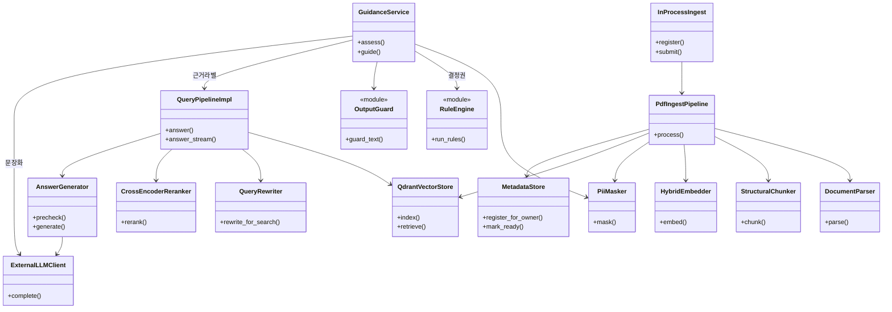

# 클래스 다이어그램 — 인슈런스핏 (현재 구현)

UML 클래스. **제품 핵심 조립**만 그린다. `_build_and_inject`([`src/harag/api/main.py`](../src/harag/api/main.py))가 실제로 붙이는 객체다.

규칙이 후보를 정하고, RAG는 근거만 붙인다. `GuidanceService`는 증상 매칭을 RAG에 맡기지 않는다.

시퀀스: [SEQUENCE_DIAGRAMS.md](SEQUENCE_DIAGRAMS.md).

---

## 표기

`RuleEngine`(`run_rules`)과 `OutputGuard`(`guard_text`)는 클래스가 아니라 **모듈 함수**다. 다이어그램에서는 역할을 보이려고 같은 상자로 그린다.

---

## 핵심 클래스

| 이름 | 역할 |
|------|------|
| GuidanceService | 상태 카드·보장 비교. 규칙이 후보, LLM은 설명 |
| PiiMasker | 형식 PII 마스킹 (법적 익명처리 아님) |
| RuleEngine | `kb.yaml` 매칭. 결정권 |
| QueryPipelineImpl | 문서 질의 오케스트레이션 |
| PdfIngestPipeline | 파싱→마스크→청킹→임베딩→적재 |
| QdrantVectorStore | owner 필터 하이브리드 검색 |

---

## 그리지 않은 것

Pydantic 스키마, FastAPI 라우트, JWT/OIDC, 컬렉션 API, Redis 워커, HWP 디코더, frontend. 시퀀스 문서와 같다.
