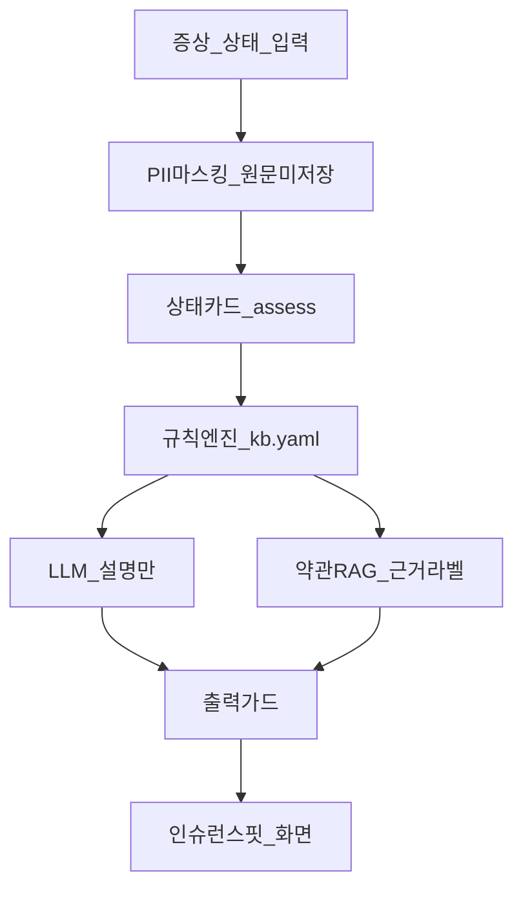

# 현재 아키텍처 — 문서 위치와 라이브 갱

목표 구조는 [TARGET_ARCHITECTURE.md](TARGET_ARCHITECTURE.md). 부품 목록은 [TECH_STACK.md](TECH_STACK.md). 재정의 이유·갭은 [PROFESSOR_FEEDBACK.md](PROFESSOR_FEEDBACK.md) §7–9.

---

## 어디가 정본인가

읽을 순서:

1. **[TARGET_ARCHITECTURE.md](TARGET_ARCHITECTURE.md)** — **지금 제품의 목표·현재 구조**. 교수님 피드백 이후 “상태 안내 + 약관 RAG 근거”.
2. **[PROFESSOR_FEEDBACK.md](PROFESSOR_FEEDBACK.md)** §7–9 — 왜 이렇게 바꿨는지, 코드 갭.
3. **[TECH_STACK.md](TECH_STACK.md)** — 무엇을 쓰는지(구현 부품).
4. **[README.md](../README.md)** — 한 줄 목적 + 실행.
5. **[SEQUENCE_DIAGRAMS.md](SEQUENCE_DIAGRAMS.md)** — 상태 안내·적재·질의 UML 시퀀스.
6. **[CLASS_DIAGRAM.md](CLASS_DIAGRAM.md)** — Guidance + RAG 핵심 클래스.

**[MASTER_DESIGN.md](../MASTER_DESIGN.md)** 와 `설계/harag_project/docs/` 는 **한글 행정문서 FAQ RAG**(HWP, GPU 임베딩, K8s, Postgres 기본)다. 인슈런스핏 발표용 아키텍처로 쓰면 안 된다. 약관 RAG 뒷단(파싱·청킹·Qdrant·abstain)만 그 자산의 수직 슬라이스다.

---

## TARGET가 그리는 구조 (실제 코드와 맞음)

라이브 배선:

- UX: [`frontend/index.html`](../frontend/index.html) + [`sangtae.js`](../frontend/sangtae.js)
- API: `POST /v1/assess` · `/v1/guidance` · 문서 업로드 · `/v1/query/stream`
- 규칙: [`src/harag/guidance/`](../src/harag/guidance/) (`engine` 결정, `guard` 진단 금지)
- RAG: [`InProcessIngest`](../src/harag/api/ingest.py) → Qdrant owner 필터 → [`QueryPipeline`](../src/harag/api/pipeline.py)

결정권은 규칙, LLM은 문장화. RAG는 증상 매칭을 하지 않고 근거만 붙인다. 문서 질의 탭은 병행한다.

---

## MASTER_DESIGN과의 차이 (혼동 금지)

- MASTER: 인증된 사용자, 읽기/쓰기 워커 격리, self-host GPU, Postgres+오브젝트스토리지, HWP SPOF.
- 지금: 브라우저 UUID(`X-Owner-Id`), 인프로세스 인제스트, Gemini API, SQLite+인메모리 Qdrant 가능, PDF만.

---

## 문서 vs 코드 갭

TARGET §4 지표(원본 TTL 감사, 규칙 이탈률, 인용 비율 CI)는 **아직 집계 코드 없음**.

PII는 주민·전화·이메일 등 **형식 정규식**뿐, 이름·주소 NER 없음.

안내 원문은 세션에 안 넣음(`raw_stored=False`). 올린 약관 청크는 Qdrant/SQLite에 **마스킹 후 영속**.

폴링은 90초에서 멈춰 긴 임베딩 중 UI가 처리중으로 남을 수 있음.
