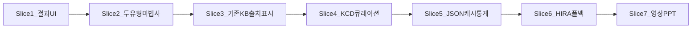

# 점진 기능 개발 — 10일 슬라이스

오늘은 2026-10-20, 마감 가정은 10-30 전후. 교수 우선은 **보이는 결과**와 **작동 영상**이다. API가 없어도 시연이 되게 두고, 공공 API는 캐시 뒤에만 붙인다.

면담 해석의 정본은 [PROFESSOR_FEEDBACK_OCT20.md](PROFESSOR_FEEDBACK_OCT20.md). 목표 흐름은 [SEQUENCE_DIAGRAMS.md](SEQUENCE_DIAGRAMS.md) SD-04.

---

## 지금 라이브

칩 5종 복수 선택. [`GuidanceService`](../src/harag/guidance/service.py)가 규칙으로 보장 4종을 고르고 LLM은 설명만. Open API·캐시 없음.

슬라이스 2: 3단계 마법사(증상 → 나의 상황 → 결과). 화면은 **자주 느끼는 증상** / **놓치기 쉬운 불편**. 기존 5종은 전자. 후자는 접힌 빈 칸(출처 확인 전). 결과 상단에 유형 배지와 영역 겹침(`n개 중 m개`).

---

## 반복 루프 (매 슬라이스)

1. 계약: 사용자에게 무엇이 새로 보이는지 한 줄.
2. 테스트: 백엔드를 건드리면 [`tests/behavior/test_guidance.py`](../tests/behavior/test_guidance.py)에 실패하는 테스트를 먼저.
3. 구현: 그 슬라이스만. 의학 매핑은 기존 출처가 있는 5종만.
4. 확인: 브라우저에서 칩 복수 선택 → 안내 받기. 약관 탭은 깨지지 않게만 본다.
5. 정직성: 교수 요청(두 유형·근거·복수·보험 종류)과 팀 설계(캐시·HIRA·그룹 헤더)를 섞어 쓰지 않는다.

게이트(위반 시 그 슬라이스 중단):

- 출처 없는 새 증상·KCD·「다리가 근지러움 → 혈압/혈당」 확정 매핑 금지
- 사용자 문장을 공공 API에 보내지 않음 (KCD만)
- 나이를 안 받는데 「당신 연령대」라고 쓰지 않음
- 진단 UI 금지. persist 0 감사·NHIS·월납 추천은 이번에 안 함

---

## 슬라이스

| 슬라이스 | 보이는 결과 | 만지는 곳 | 안 하는 것 | 상태 |
|----------|-------------|-----------|------------|------|
| 1 결과 UI | 보험(보장) 종류가 맨 위, 한눈에. 영역·설명은 아래. 약관은 접힘 | [`frontend/sangtae.js`](../frontend/sangtae.js), [`frontend/sangtae.css`](../frontend/sangtae.css) | 백엔드·KB 변경(약관 근거 튜플 언팩 버그만 고침) | 완료 |
| 2 두 유형 마법사 | 증상/상황/결과 3단계. 자주 느끼는 5칩 + 접힌 놓치기 쉬운 영역. 트레이·ⓘ·결과 유형 배지·겹침 | [`frontend/index.html`](../frontend/index.html), [`sangtae.js`](../frontend/sangtae.js), [`kb.yaml`](../src/harag/guidance/kb.yaml) `type: usual` | 다리 가려움·혈압/혈당 매핑. 검색·부위 탭 | 완료 |
| 3 근거 노출 | 칩·결과에 KB에 이미 있는 질병관리청 출처가 보임 | UI만. 출처는 `kb.yaml` 기존 `areas.source` | 가짜 DOI | 다음 |
| 4 닫힌 코드 | 기존 5종에만 가능 질환·KCD 필드. 규칙은 그대로 보장 종류를 고름 | kb + engine + 테스트 | 라이브 API, 증상 확대 | 다음 |
| 5 JSON 캐시 | 「참고 통계」블록. 연령을 안 받으면 연령대 문장 없음 | `data/hira_cache/*.json` + GuidanceService | 포털 키 필수 아님 | 다음 |
| 6 HIRA | 키 있으면 KCD만 조회, 실패·지연 시 5번 캐시 | 새 클라이언트, 타임아웃. 문서에 가짜 URL 없음 | 캐시 없는 시연 | 다음 |
| 7 제출 | 작동 영상 + PPT 뒷단은 SD-04 | 문서·영상. 코드 최소 | AWS·canary·월납 | 다음 |

후속(이번 10일 밖, 자소서용): NHIS 시범, persist 0 감사, 월납 추천, 증상 수십 개.

분류 표 숙제는 없다. 슬라이스 2의 `type` 필드와 「놓치기 쉬운 불편」은 **팀 UX**다. 화면에서 「숨은 신호」라고 쓰지 않는다.

---

## 데모 스크립트 (슬라이스 2)

1. [http://localhost:8000](http://localhost:8000) 연다.
2. 스테퍼가 **증상 / 나의 상황 / 결과**인지 본다.
3. **두통**과 **요통**을 같이 고른다. 하단 트레이에 2개가 생긴다.
4. 「혹시 이런 불편도」를 펼치면 빈 칸과 「해당 없음」이 있다. 「숨은 신호」라는 말은 없다.
5. 「다음: 나의 상황」→ 직업·걱정은 건너뛰어도 된다.
6. 「이 상태로 안내 받기」.
7. 결과에 **자주 느끼는 증상 (두통)(요통)** 과 **놓치기 쉬운 불편 해당 없음**, 그다음 실손 보장 카드, **선택한 n개 중 m개와 관련**이 보인다.
8. 「약관에 질문」은 그대로 열린다.

---

## 정직성 한 줄

- 교수 요청: 두 유형, 근거, 복수 선택, 뒷단 의학적 기준, 보험 종류 연결, 보이는 UI, 작동 영상.
- 팀 선택: `입력 → 규칙(KCD) → Open API/캐시 → LLM`, 그룹 헤더, JSON 캐시, HIRA 클라이언트.
- 말하지 않음: 분류 표 숙제, 공단 빅데이터 플랫폼 실시간, 확진, 상품명 권유.
