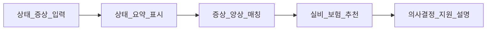

# 교수님 피드백 분석·제품 재정의

급히 적은 메모를 바탕으로 정리한 문서다. 앞뒤가 어긋난 표현은 반복 메시지를 우선해 해석했다.

> **한 줄:** PDF RAG “설명 챗봇”이 목표가 아니다.  
> **개인정보 최소 입력으로 증상·상태에 맞는 건강보험을 추천·설명해 의사결정을 돕는 규칙 기반 LLM**으로 목표를 재정의한다.  
> 설계 주축은 **프라이버시**(비식별·원본 즉시 삭제·입력·출력 이중 통제)이며, 기존 구현만으로는 부족하고 **참신한 차별점**이 필요하다.

관련: [REMAINING_WORK.md](../REMAINING_WORK.md) · [README.md](../README.md)

---

## 1. 가장 큰 지적 — 목표·목적이 어긋남

| 피드백 당시 MVP | 교수님이 본 목표 |
|-----------------|------------------|
| 건강보험 **안내 PDF** 근거 기반 Q&A | **그 사람 상태에 맞는** 건강보험 **추천·의사결정 지원** |
| “설명 챗봇” | FAQ형 챗봇이 아님 → **규칙에 기반한 LLM** |
| RAG·인덱싱·인젝션 방어가 서사 중심 | **프라이버시 + 상태→증상→보험 매칭**이 서사 중심 |

이후 코드: 상태 안내 탭·규칙 엔진·라이브 PII가 있다. 문서 질의는 병행. 현재 갭은 §7.

교수님이 물은 것: *“이게 어떤 목적에 쓰이는지가 명확하냐?”*  
→ 발표·문서의 **한 줄 목적문**을 아래로 교체한다.

### 재정의 목적문 (확정)

최소 수집으로 **증상·상태만** 받아(주민번호·로그인 ID 등은 받지 않음),  
관련 양상과 실비·건강보험을 **정보 제공·비교 안내**해 의사결정을 돕는 서비스.  
(규제 리스크를 피하기 위해 단기 포지션은 “추천/모집”이 아니라 **안내**로 고정한다. 상세: §9.)

---

## 2. 설계 기준 — 가용성 / 안정성 / 보안성 중 무엇을 주축으로

세 축을 동시에 “다 중요”라고 하지 말고, **이 서비스가 가장 필요로 하는 축**을 명시한다.

| 축 | 피드백 | 이 서비스에서의 해석 |
|----|--------|----------------------|
| 가용성 | **굳이 필요 없음** | 24/7 SLA를 제품 핵심으로 잡지 않음 |
| 안정성 | **어떻게 측정할지** 정할 것 | 추천 일관성, 규칙 위반율, 환각·오추천율 등 |
| 보안성 | **방향 = 프라이버시** | 민감 건강·보험 맥락 → 비식별·최소수집·원본 삭제 |

**확정:** 주축 = **보안성(프라이버시)**. 보조 = **안정성(측정 가능한 정확·일관)**. 가용성은 부차.

정확도만을 위해 프롬프트에 민감정보를 넣는 방식은 지양하고, **처리(파이프라인) 단계에서 프라이버시를 보장**한다.

### 안정성 측정 지표 (초기안)

| 지표 | 의미 |
|------|------|
| 규칙 이탈률 | LLM이 규칙 엔진이 허용하지 않은 상품·주장을 낸 비율 |
| 금지 출력 차단률 | 의료 확진 단정·개인정보 재출력 등 가드가 막은 비율 |
| 추천 일관성 | 동일 상태 입력에 대한 상위 추천 집합의 안정성 |
| 오추천·환각 샘플 | 골드셋/적대 케이스에서 근거 없는 추천 |

---

## 3. 프라이버시 — “구현만 했다”와 추가 요구

입력단 PII 마스킹 등 **이미 한 것은 유지**한다. 그 위에:

1. 프레임을 **프라이버시 비식별화**로 말할 것  
2. **원본 데이터는 즉시 삭제** (적재·로그·외부 LLM 경로에 원본이 남지 않게)  
3. **기존 내용 말고 참신한 요소** — “구현에서만 끝남. 참신함 필요”

정규식 마스킹만으로는 부족하다. **제품 차별점과 연결된 프라이버시 스토리**가 필요하다.

참신함의 방향(§5와 동일):

- 삼성 등처럼 **ID/PW·개인정보 로그인** 없이도  
- **상태만** (“머리가 아파요”, “서비스직 + 다리에 쥐”)으로  
- 보험을 제안 → **최소수집이 곧 UX 차별점**

---

## 4. “챗봇이 아니다” — 규칙 기반 LLM

| 용어 | 의미 |
|------|------|
| (일반) 챗봇 | 미리 정해진 FAQ에 답하는 형태 |
| 요구 | **규칙을 탄탄히** 잡고, 그 위에서 LLM을 쓰는 **규칙 기반 LLM** |
| 통제 | **입력만** 또는 **출력만**이 아니라 **입력 + 출력 둘 다** |
| 포지션 | 입력을 안 받을 수는 없으니, **들어온 민감 입력을 잘 처리한다** |

설계 함의:

- 증상 → 질환 양상 → 보험 상품 매핑을 **규칙 / 테이블 / 지식**으로 먼저 고정  
- LLM은 설명·문장화·모호한 표현 해석  
- **추천 후보·금지는 규칙 엔진이 결정**  
- 출력 통제: 허용 상품·조항·면책만, **의료 진단 단정 금지**

---

## 5. 제품 차별점 · 화면 · 앞단/뒷단

### 기존 안내 사이트 vs 우리

| 기존 (예: 대형 보험사) | 우리 |
|------------------------|------|
| 로그인·개인정보 → 정확할 수 있음 | **개인정보 없이도** 상태 기반 제안 |
| ID/Password 중심 | “상태만 입력해도 건강보험 추천” |

### UX 흐름

1. 사람의 **상태를 먼저 보여줌**  
2. 그에 대한 정보를 돌림  
3. **의사결정을 용이**하게  

### 데이터·로직 (핵심 IP)

- 증상명 → 관련 질환·양상 (예: 다리 쥐 ↔ 갑상선 등 — **확진이 아니라 매칭 가설·교육용 링크**)  
- 직업·맥락 (서비스직 + 다리 쥐) → 관련 **실비 보험 추천**  
- 증상–원인–보험을 잇는 **매칭 데이터**

화면은 채팅만으로 끝내지 않고, **상태 진단형 앞단 + 추천·근거 뒷단**을 둔다.  
현재 PDF RAG는 **약관·안내 근거 설명용 뒷단 엔진**으로 재배치할 수 있다.

---

## 6. 요구사항 문장 (피드백 → 스펙)

1. **목적:** 개인정보 최소 입력으로, 상태에 적합한 건강보험을 추천·설명해 의사결정을 돕는다.  
2. **정체성:** FAQ 챗봇이 아니라 **규칙 기반 LLM 추천·설명 시스템**.  
3. **설계 주축:** 프라이버시(비식별·원본 즉시 삭제·입력·출력 통제). 가용성 비주력. 안정성은 측정 지표와 함께.  
4. **차별점:** 로그인·민감 개인정보 없이도 증상/상태로 추천.  
5. **참신함:** 증상–양상–보험 매칭 지식 + 상태 우선 UX + 원본 즉시 삭제 파이프라인.  
6. **현 RAG MVP:** 문서 근거 설명 엔진으로 **뒷단 자산**은 유지하되, **제품 목표·UI·규칙 레이어를 새로** 올린다.

---

## 7. 현재 레포와의 갭

상태 안내 MVP 이후 기준이다. (이전 스냅샷: PII 미배선·상태 UX 없음.)

| 구분 | 내용 |
|------|------|
| 있음 (라이브) | PDF RAG, ACL, 인젝션·인용 가드, abstain, 업로드 스풀 삭제, **InProcessIngest PII 마스킹**, **상태 안내 UX**, **증상 5종 KB·규칙 엔진**, `POST /v1/assess`·`/v1/guidance` (원문 세션 미저장) |
| 있음 (우회 자산) | `IndexingWorker` PII는 주입 시에만. 라이브 경로는 `InProcessIngest` |
| 약함/없음 | 원본 TTL=0 **감사 지표**, 안정성 지표 집계, 이름·주소 NER, KB 확대 |

목표 파이프라인은 [TARGET_ARCHITECTURE.md](TARGET_ARCHITECTURE.md). 골격은 코드에 있고, 계측·지식 확대는 남았다.

---

## 8. 단기 스코프 (구현됨 / 남은 것)

**구현됨:** 상태만 입력 → 비식별·원문 미저장 → 상태 카드 → 규칙 매칭 안내  
(+ 업로드된 약관이 있으면 RAG 근거 라벨)

**남은 것:** TTL 감사 로그, 골드셋·안정성 지표, KB 확대. 상세는 [REMAINING_WORK.md](../REMAINING_WORK.md) §C.

---

## 9. 정합성 점검 (다른 생성형 AI 해석 × 코드)

다른 AI의 세 질문 프레임(“무엇을 위해 / 어떤 기준으로 / 기존과 뭐가 다른가”)과  
“구현은 됐지만 이 답은 약하다”는 진단에 **동의**한다.

### 9.1 채택한 해석

- 입력 통제 vs 처리 중심이 **상충이 아님**:  
  **입력 즉시 비식별 → 처리(규칙) → 출력 검증**을 **한 정책 파이프라인**으로 묶으라는 뜻.
- 신뢰 주축 = **프라이버시**, 보조 = **안정성(측정)**, 가용성 = 비주력.
- 기존 RAG는 폐기하지 않고 **약관 근거 뒷단**으로 재사용.

### 9.2 코드로 보정한 점

| 주장 | 점검 |
|------|------|
| PII 마스킹이 있다 | **라이브 인제스트·안내 경로에 배선.** 형식 PII(주민·전화·이메일·계좌·여권)만. 이름·주소는 못 잡음. `IndexingWorker`는 주입 시에만 |
| 스풀 저장 = 원본 미삭제 | 임시 PDF는 처리 후 `unlink`. 안내 원문은 `ConversationStore`에 넣지 않음. TTL=0 **감사 지표는 아직 없음**. Qdrant·SQLite 문서는 영속 |
| 창구 직원용 UI | 과장. 개인 세션. **상태 안내 탭이 기본**, 문서 질의는 병행 |

### 9.3 포지션·리스크 (발표·설계 시 필수)

1. 증상도 **민감정보**가 될 수 있음 → “개인정보 안 받음”이 아니라 **최소 수집 + 즉시 비식별**.  
2. 증상→질환은 **확진 금지** — “가능한 관련 영역 + 면책”.  
3. 단기 제품 언어는 **정보 제공·비교 안내** (보험 모집·광고형 “추천”은 규제 확인 전 사용 자제).  
4. 매칭 데이터는 **공신력 출처 + 한계 명시**가 신뢰의 약한 고리.

### 9.4 발표용 구분

- **지금 데모:** 상태 안내 MVP(증상 5종 규칙 + 면책)와 문서 질의(약관 근거 엔진) **병행**.  
- **아직 아닌 것:** 원문 TTL 계측, 안정성 지표 대시보드, 완성된 보험 안내 제품.  
현 MVP를 “완성된 제품”으로 포장하지 않는다.
