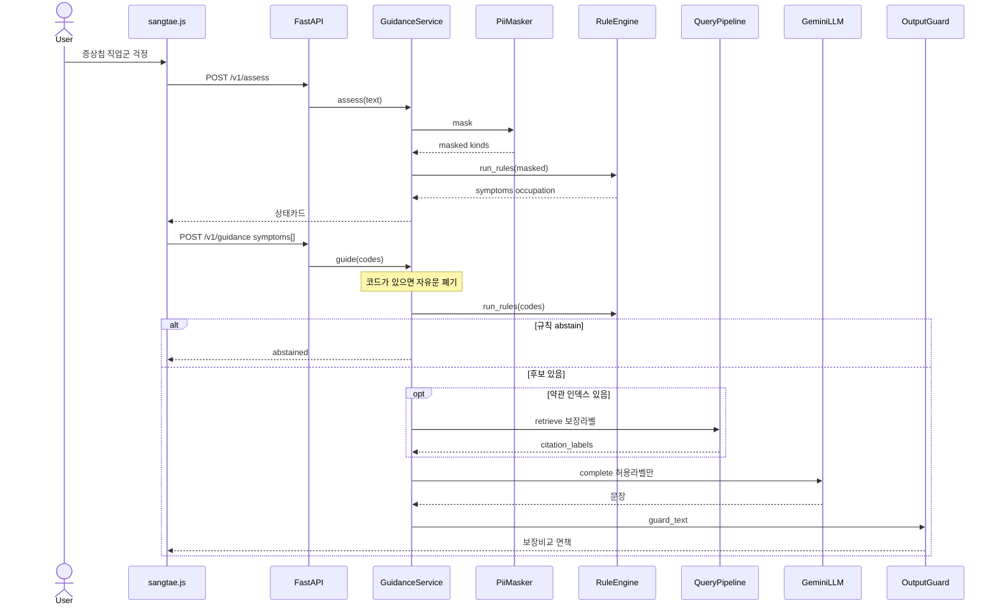
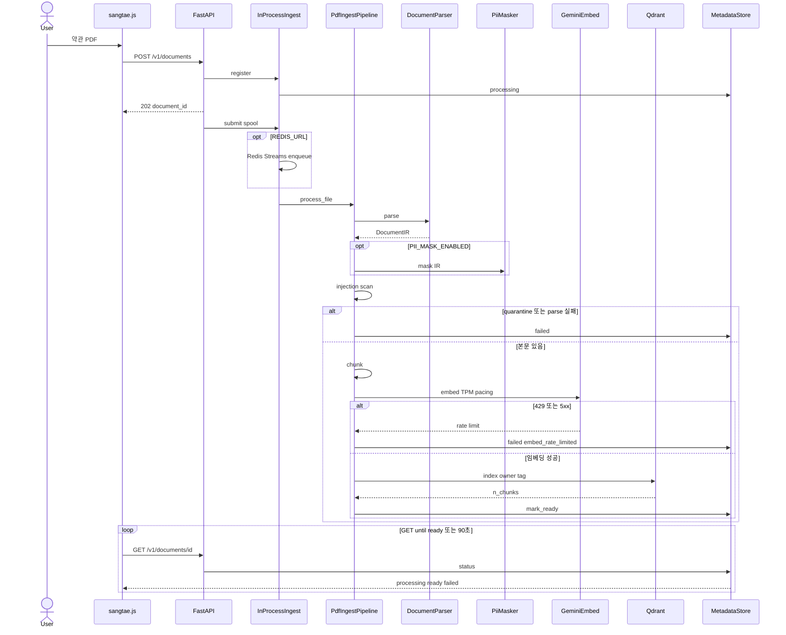
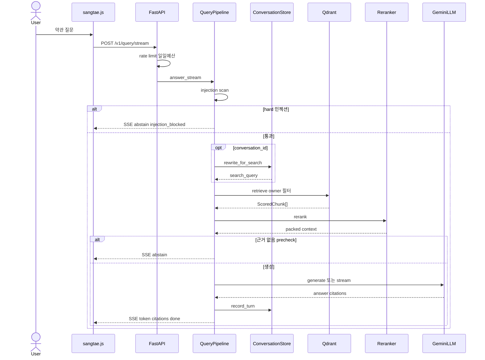
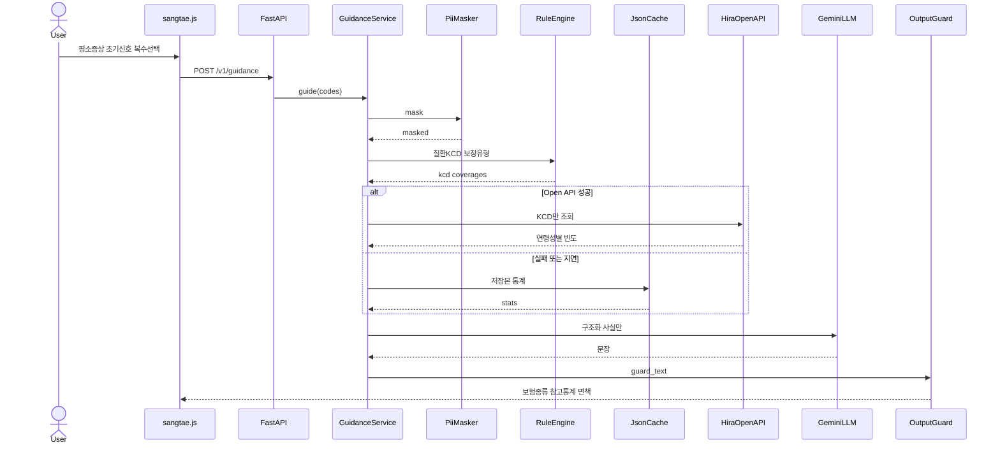

# 시퀀스 다이어그램 — 인슈런스핏 (현재 구현)

UML 2 시퀀스. SD-01~03은 **지금 돌아가는 코드**. SD-04는 10일 목표(심평원·공단 Open API + JSON 캐시)이며 아직 코드에 없다.

제품 주경로는 SD-01이다. 약관 적재(SD-02)와 문서 질의(SD-03)는 병행 탭이다. PPT 뒷단 1페이지는 SD-04를 쓴다.

관련: [CURRENT_ARCHITECTURE.md](CURRENT_ARCHITECTURE.md), [TARGET_ARCHITECTURE.md](TARGET_ARCHITECTURE.md), [CLASS_DIAGRAM.md](CLASS_DIAGRAM.md), [PROFESSOR_FEEDBACK_OCT20.md](PROFESSOR_FEEDBACK_OCT20.md).

---

## 참가자

| 생명선 | 모듈 |
|--------|------|
| User | 브라우저 사용자 |
| sangtae.js | [`frontend/sangtae.js`](../frontend/sangtae.js) |
| FastAPI | [`src/harag/api/routes_guidance.py`](../src/harag/api/routes_guidance.py) · [`routes_ingest.py`](../src/harag/api/routes_ingest.py) · [`routes_query.py`](../src/harag/api/routes_query.py) |
| GuidanceService | [`src/harag/guidance/service.py`](../src/harag/guidance/service.py) |
| PiiMasker | [`src/harag/security/pii.py`](../src/harag/security/pii.py) 형식 정규식 |
| RuleEngine | [`src/harag/guidance/engine.py`](../src/harag/guidance/engine.py) + `kb.yaml` |
| OutputGuard | [`src/harag/guidance/guard.py`](../src/harag/guidance/guard.py) |
| PdfIngestPipeline | [`src/harag/indexing/pdf_pipeline.py`](../src/harag/indexing/pdf_pipeline.py) |
| QueryPipeline | [`src/harag/api/pipeline.py`](../src/harag/api/pipeline.py) |
| Qdrant | [`src/harag/retrieval/qdrant_store.py`](../src/harag/retrieval/qdrant_store.py) owner 필터 |
| GeminiLLM / GeminiEmbed | OpenAI 호환 HTTP |
| ConversationStore | 문서 질의 이력만 (Redis 또는 메모리) |
| MetadataStore | SQLite 기본 문서 상태 |

---

## SD-01 상태 안내 (주경로)

증상 칩·직업군·걱정 → 상태 카드 → 보장 유형 비교. 규칙이 후보를 정하고 LLM은 허용 라벨만 문장화한다. `guide`에 증상 코드가 있으면 자유문은 버린다.

---

## SD-02 약관 적재

`POST /v1/documents`는 202와 `document_id`만 돌려주고 백그라운드에서 인덱싱한다. UI는 상태 API를 폴링한다(약 90초에서 멈춤).

---

## SD-03 문서 질의

약관 RAG. 소유자 격리 검색 후 LLM이 답하고, 근거가 없으면 abstain. 대화 이력은 이 경로에만 남는다.

---

## SD-04 근거 보강 (목표, 10일) — 코드 없음

두 유형(평소 증상 / 잘 안 느껴지는 초기 신호)과 복수 선택은 **교수 요청**.  
공공 API·JSON 캐시와 `입력 → 규칙(KCD) → Open API/캐시 → LLM` 순서는 **팀 설계**다.  
NHIS 빅데이터 플랫폼은 그리지 않는다. 증상 문장은 API로 나가지 않는다.

---

## 그리지 않은 것

창구 SSO, 컬렉션 API, 공유 문서함은 GitHub `main`에 있으나 **인슈런스핏 UI(`sangtae.js`) 밖**이라 SD-01~03에 넣지 않았다. HWP/DOCX 파서는 SD-02 parse 단계에 포함될 수 있으나 제품 화면의 기본 동선은 PDF다.

NHIS 빅데이터 플랫폼(신청·심의 표본)은 10일 목표에 없다. persist 0 감사·canary 집계는 설계 목표이며 SD-04 메시지에 넣지 않는다.
