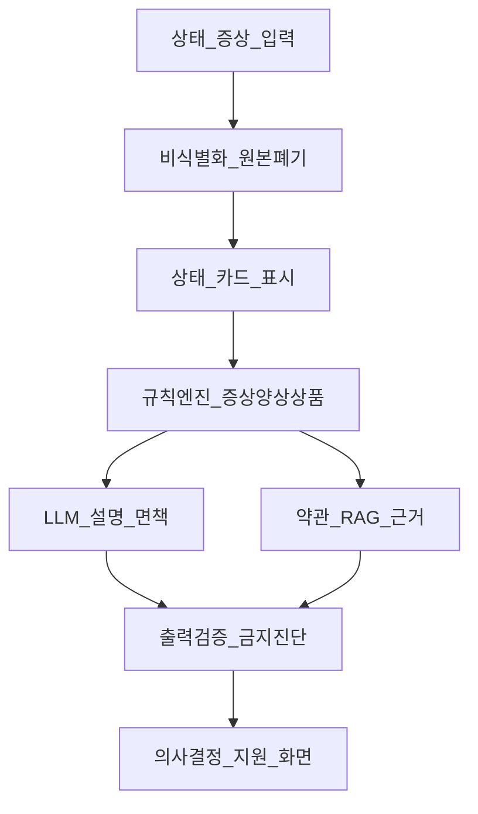
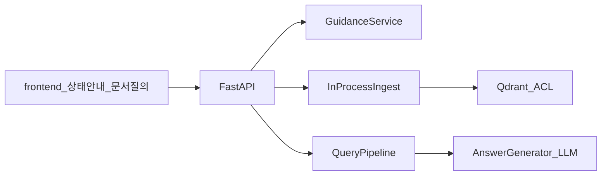

# 목표 아키텍처 — 프라이버시 중심 상태 안내 + RAG 근거

현재 구현·문서 위치는 [CURRENT_ARCHITECTURE.md](CURRENT_ARCHITECTURE.md)를 본다.

피드백 재정의([PROFESSOR_FEEDBACK.md](PROFESSOR_FEEDBACK.md))에 맞춘 **목표** 구조다.  
지금 돌아가는 PDF RAG MVP는 이 중 **뒷단 근거 엔진**에 해당한다.

---

## 1. 한 줄

> 최소 수집 증상·상태만 받아 **즉시 비식별·원본 폐기**하고, **규칙이 후보를 결정**한 뒤 LLM이 설명하며, 약관 RAG로 **근거를 붙이는** 프라이버시 중심 **정보 제공·비교 안내** 서비스.

신뢰 주축: **보안성(프라이버시)**.  
보조: **안정성**(측정 가능 지표).  
가용성: 비주력.

---

## 2. 파이프라인

| 단계 | 하는 일 | 하지 않는 일 |
|------|---------|--------------|
| 입력 | 증상·상태·직업 맥락 등 최소 필드 | 주민번호·로그인 ID·병력 전문 강제 수집 |
| 비식별 | PII/식별자 제거, 원본 TTL→0 | 원본을 로그·벡터·LLM에 장기 보관 |
| 상태 카드 | 사용자에게 “이해한 상태”를 먼저 보여줌 | 의료 진단서처럼 보이게 함 |
| 규칙 엔진 | 증상–양상–상품 **후보 결정**(결정권) | LLM이 마음대로 상품을 고르게 둠 |
| LLM | 문장화·모호 표현 해석·면책 문구 | 확진·규칙 밖 상품 주장 |
| RAG | 약관·안내 PDF에서 **근거 청크** | 증상 매칭 자체를 RAG에 맡김 |
| 출력 가드 | 진단 단정·규칙 이탈·금지 표현 차단 | 가드 없이 스트리밍만 |

---

## 3. 층별 역할과 기존 자산

| 층 | 역할 | 기존 자산 | 상태 |
|----|------|-----------|------|
| 앞단 UX | 상태 입력·상태 카드·면책 카피 | `frontend/` 상태 안내 탭 | **라이브** |
| 프라이버시 | 비식별·원본 TTL=0·지표 | [`security/pii.py`](../src/harag/security/pii.py) | 인제스트·안내 **배선**. TTL 감사 지표는 남음 |
| 규칙 | 증상–양상–보장 유형 KB/엔진 | [`guidance/`](../src/harag/guidance/) | **라이브** (증상 5종) |
| LLM | 설명만 | `llm_client` / Gemini 호환 | 유지 |
| 뒷단 RAG | 약관 근거 | 파싱·청킹·Qdrant·인용·abstain | **재사용** (업로드 시) |
| 출력 가드 | 진단 금지·규칙 이탈 | `guidance/guard.py` | **라이브** (정규식+허용 라벨) |

### 현재 MVP (참고)

기본 화면은 상태 안내. 문서 질의 탭이 약관 RAG를 병행한다.

---

## 4. 측정 지표 (안정성·프라이버시)

| 지표 | 축 | 목표 방향 |
|------|-----|-----------|
| 원본 보존 시간 | 프라이버시 | 0에 수렴 (처리 후 즉시 폐기) |
| 비식별 후 재식별 위험 샘플 | 프라이버시 | 골드셋 적대 케이스로 감시 |
| 규칙 이탈률 | 안정성 | LLM이 규칙 밖 상품·주장을 낸 비율 ↓ |
| 금지 출력 차단률 | 안정성 | 확진 단정 등 가드 적중 |
| 근거 인용 비율 | 안정성 | 안내 문장에 약관 근거 부착 |
| 동일 입력 추천(안내) 일관성 | 안정성 | 상위 후보 집합 안정 |

가용성(24/7 SLA)은 제품 핵심 지표로 두지 않는다.

---

## 5. 차별점 (기존 보험 안내 사이트 대비)

| 기존 (로그인·식별자 중심) | 본 목표 |
|---------------------------|---------|
| ID/PW·상세 개인정보로 정확도 | **최소 수집 상태**만으로 안내 |
| 계정 기반 맞춤 | 증상·직업 맥락 **규칙 매칭** + 약관 근거 |

표현은 “개인정보를 전혀 안 받는다”가 아니라  
**식별자 없이 상태만 받아 즉시 비식별한다**.

---

## 6. 구현 순서 (문서 → 코드)

상태 안내 MVP는 코드에 있다. 문서 질의 탭과 병행한다.

- `POST /v1/assess` · `POST /v1/guidance`
- 증상 5종 KB(`src/harag/guidance/kb.yaml`) + 규칙 엔진 + 출력 가드
- 라이브 인제스트 PII 마스킹, 안내 경로 원문 미저장
- 약관 RAG는 업로드된 문서가 있을 때 근거 라벨을 붙인다

남은 일: 지식 베이스 확대, 원문 TTL 감사 지표, 골드셋 CI.

세부 피드백·갭은 [PROFESSOR_FEEDBACK.md](PROFESSOR_FEEDBACK.md) §7–9.
