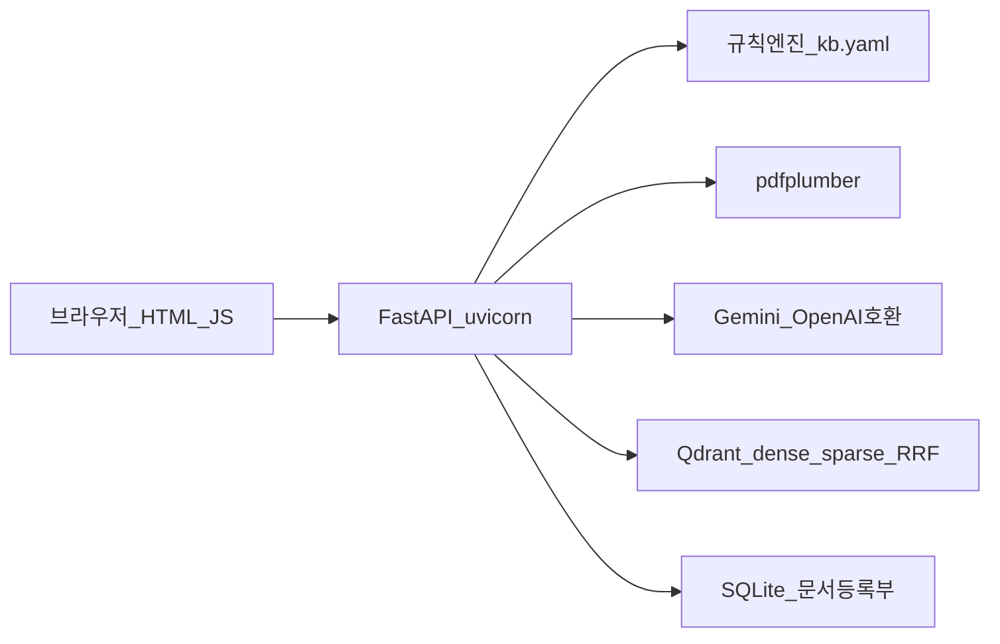

# 인슈런스핏 기술 스택

제품 이름은 **인슈런스핏**, 코드/패키지는 **harag**. Python 3.11+ (`Dockerfile`은 3.12-slim). 프론트는 프레임워크 없이 같은 FastAPI가 정적 파일로 서빙한다.

Gemini 한도·모델 역할은 [GEMINI_COST_STRATEGY.md](GEMINI_COST_STRATEGY.md). 실행은 [실행_가이드.md](실행_가이드.md).

## 지금 데모에서 쓰는 것

- **앱:** FastAPI, Uvicorn, Pydantic v2, httpx, python-multipart
- **화면:** `frontend/index.html` + `sangtae.js` / `sangtae.css` (React/Vue 없음). 질의는 SSE(`text/event-stream`)
- **상태 안내:** 자체 규칙 엔진 + [`src/harag/guidance/kb.yaml`](../src/harag/guidance/kb.yaml), LLM은 설명만
- **약관 RAG:** pdfplumber 파싱 → 구조 청킹 → PII 마스크 → 임베딩 → Qdrant
- **LLM/임베딩 (현재 .env 경로):** Google AI Studio Gemini, OpenAI 호환 `/v1`
  - 임베딩 `gemini-embedding-001` (768차원, TPM 페이싱)
  - 답변 Flash, 재작성 Flash-Lite
- **검색:** Qdrant hybrid (dense + sparse RRF). 로컬은 `QDRANT_URL` 비움 → 인메모리. Compose면 `qdrant/qdrant`
- **문서 메타:** SQLAlchemy + SQLite (`./data/harag.db`)
- **보안/한도:** 정규식 PII 마스킹, owner 헤더 ACL, `RATE_LIMIT_QPM`, 임베딩 429 재시도
- **테스트:** pytest / pytest-asyncio
- **배포 옵션:** Docker Compose (api + qdrant)

## 코드에 있지만 지금은 꺼 두거나 선택인 것

- **LLM/임베딩 폴백:** 키 없으면 로컬 해시 임베딩 + 추출형 답변
- **형태소:** `kiwipiepy` 있으면 sparse에 사용, 없으면 어절 폴백 (`pip install -e '.[korean]'`)
- **리랭커:** LLM 리랭크 / 어휘 겹침 폴백. HTTP TEI Cross-Encoder는 `RERANKER_SERVER_URL`일 때만
- **PostgreSQL 16:** compose profile `postgres` + `psycopg`
- **JWT:** `AUTH_JWT_SECRET` 설정 시에만 강제
- **Qdrant Cloud:** URL+키 넣으면 전환
- **S3/MinIO:** `boto3`는 주석, 미설치

## 쓰지 않는 것 (오해 방지)

React, Next, LangChain, LlamaIndex, Redis, Celery, Kafka, 자체 GPU 임베딩 서버는 이 MVP 런타임에 없다.
